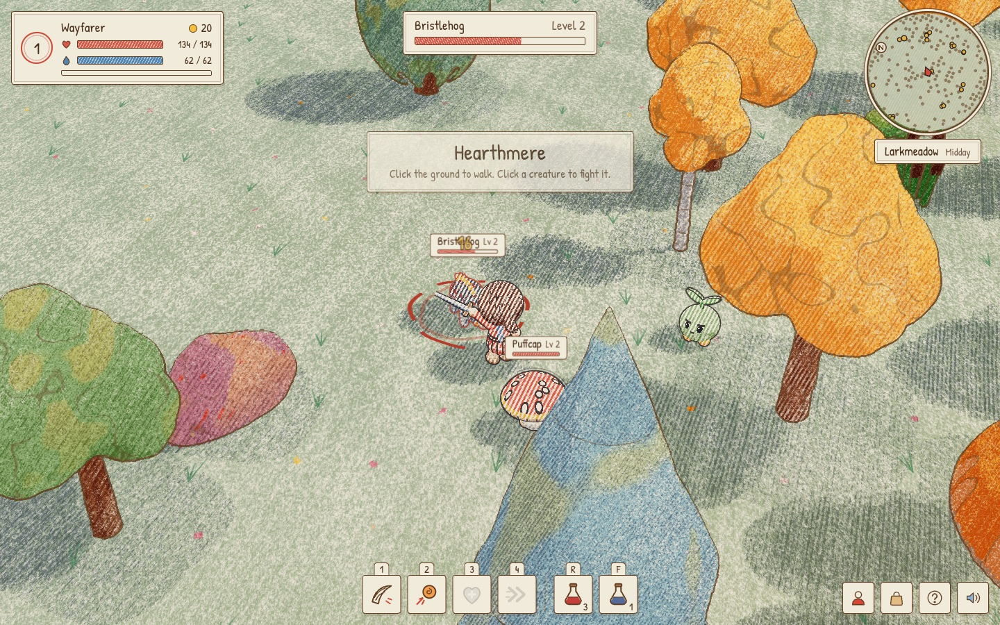
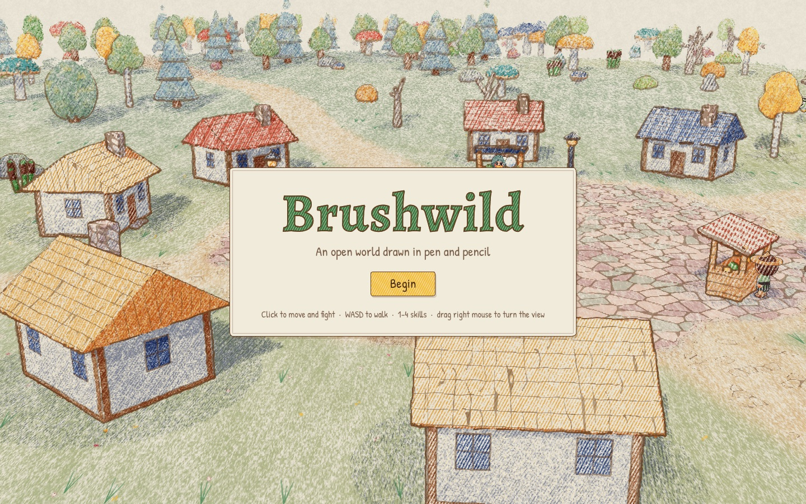
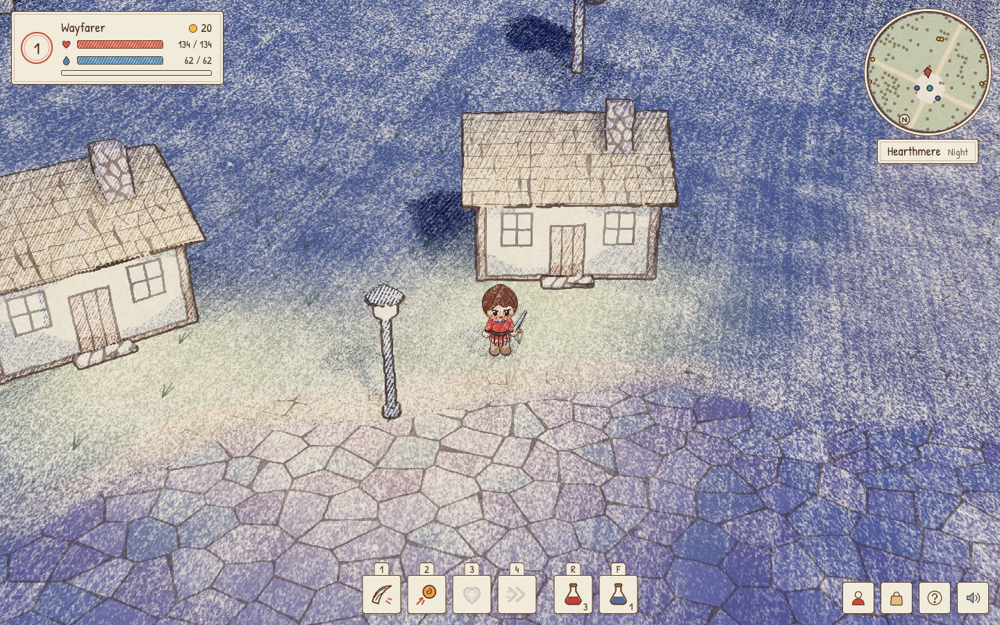
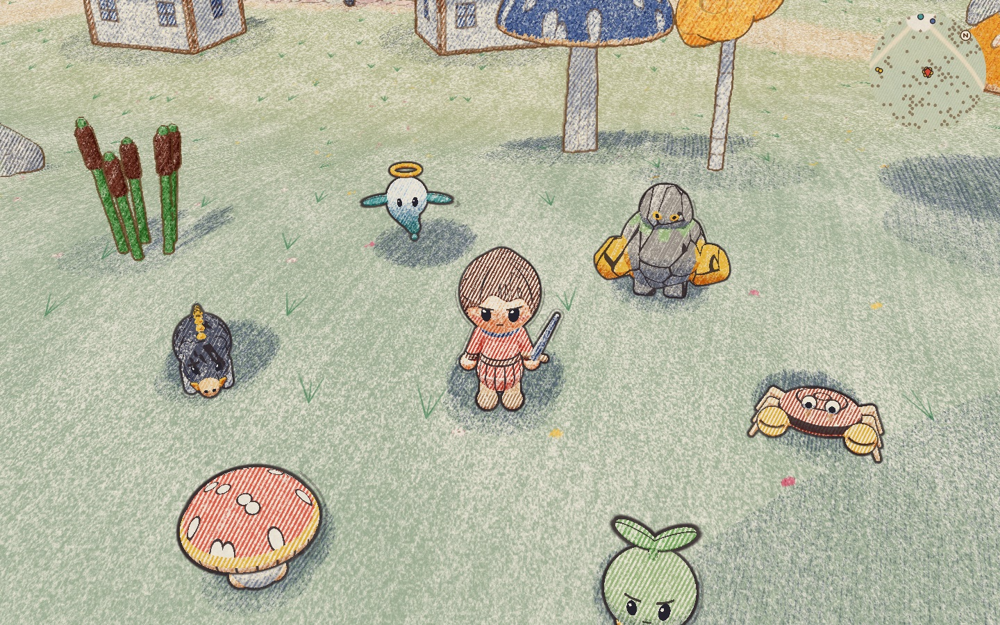
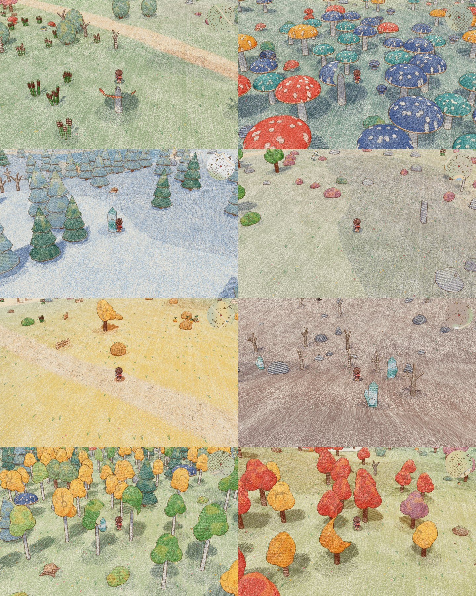
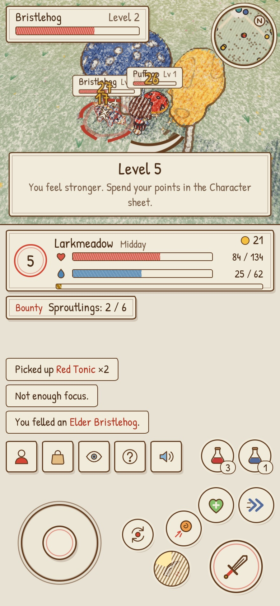
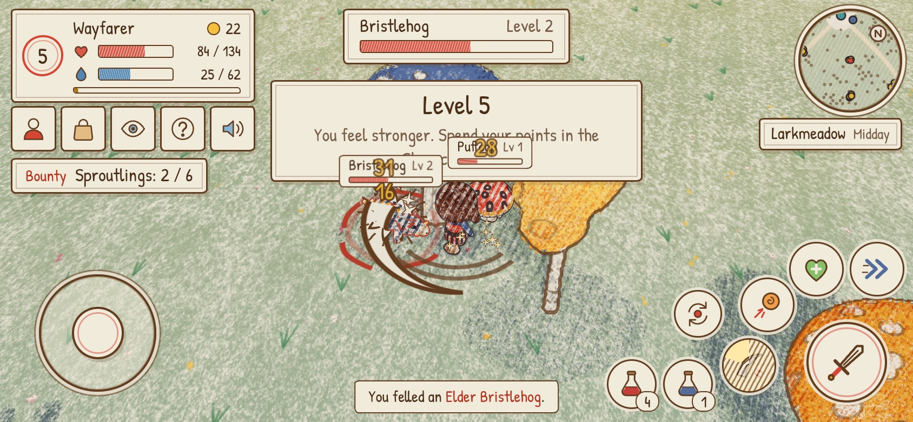

# Brushwild

An open world drawn in ballpoint and coloured pencil on cream paper, that you can play in a browser, on a desktop or a phone. Walk and fight, gather loot, level up, and wander as far as you like: the land is generated as you go. Every pixel of the game is drawn by shaders — it uses no image files, no models and no libraries.

**Play it: https://kevintngo.github.io/brushwild/**

The art style is carried over from Valsera, a 2D game drawn the same way, from baked sprites to a live 3D world: one hatch slant for the whole page, visible strokes with paper showing through, shade as a second lay of a deeper pencil, light as bare paper, a sepia pen on scenery and a bold dark contour on figures, and one mustard part on every beast: the part that hurts.



| | |
| --- | --- |
|  |  |
|  |  |

## Run it

Any static file server works; the source runs as plain ES modules with no build step.

```bash
python3 -m http.server 8080
```

Then open `http://localhost:8080`. Add `?new` to the address to start a fresh journey (progress is kept in the browser's local storage), and `?touch` to see the phone interface on a desktop.

To pack the release into `dist/` (one `index.html` with the script and styles inside it, plus the `static/` folder):

```bash
node build.js
```

(Needs Node, and network access the first time, when `npx` fetches esbuild.) The `gh-pages` branch holds that folder; `./publish.sh` rebuilds it and pushes it.

## Controls

| Input | Action |
| --- | --- |
| Left click | Walk to a spot, attack a creature, talk to townsfolk. Hold to keep walking. |
| W A S D | Walk by hand |
| 1 2 3 4 | Skills (aim at the target, or at the cursor) |
| R / F | Drink a Red Tonic / Blue Draught |
| Space / Tab | Attack the nearest creature / pick the next one |
| Right drag, Q / E | Turn and tilt the view. A journey starts low behind the hero, looking to the horizon; tilt up for the view from above. |
| Wheel | Zoom |
| C / B / V | Character sheet / bag / the view (two ready-made views, and buttons to turn, tilt and zoom) |

On a touch screen:

| Input | Action |
| --- | --- |
| Stick (left thumb) | Walk. It appears where the thumb lands; pushed part-way it strolls. |
| Tap the picture | Walk to a spot, attack a creature, talk to townsfolk |
| Sword button | Attack the nearest creature, or talk to someone close. Hold it to carry the fight on to the next creature. |
| Round buttons | Skills (aim at the target, or at the nearest creature) and the two flasks |
| Arrows button | Pick the next creature |
| Drag the picture / pinch | Turn and tilt the view / zoom. The View menu has buttons for both. |

Held sideways, the picture fills the screen and the controls sit in its corners. Held upright, the picture is a strip across the top (16:9, growing to 5:4 on a tall phone) and everything else is laid out on the page below it: status, messages, menus, then the stick and the buttons under the thumbs.

| | |
| --- | --- |
|  |  |

A new journey opens with five first steps, each finished by doing it: walk to a ring, turn the view, fight a practice creature, use a skill, take a bounty. A plate says what to try, the button to press is ringed in red, and an arrow at the edge of the picture points to a goal that is out of sight. It can be skipped, and the How to Play sheet brings it back. Later, a one-line tip appears the first time it is needed (a flask when health runs low, the character sheet when there are points to spend).

## How it is drawn

1. **World pass** — one full-screen raymarch of the terrain heightfield, every prop (trees, rocks, houses are signed-distance shapes) and the sea. It does not produce a picture. For every pixel it decides *what is to be drawn*: which pencil, how firmly it is laid, how much shading goes over it, and what pen marks sit on it (stone joints, roof courses, leaf scribble). It runs at an internal resolution that adapts to measured GPU time.
2. **Ink pass** — finds the contours from depth steps, object silhouettes and folds.
3. **Entity pass** — each creature is a small distance-field model raymarched inside a camera-facing quad at full device resolution, already drawn in the same hand: bold contour, pencil hatching that rides with the figure and is re-laid six times a second (a quiet boil), poses stepped on twos. Effects are pen-and-paper marks in the same layer.
4. **Final pass** — draws the page at device resolution: paper with tooth, the pencil lay in strokes, a second lay of a deeper pencil for shade, pen doodles (grass tufts, ripples), the pen along the contours (wobbling, pressing unevenly, sometimes going over twice), then the figures on top. A hero hidden behind scenery is shown as a pen outline, never as a faded figure. The minimap is a little paper map drawn here too.

Hatching is laid in *paper coordinates*: positions on flat sheets, projected on the right and up axes of a held view direction. That direction stays put while the camera travels or turns, so strokes stay glued to the world and never swim; once the view has turned about 17 degrees away from it, or has come to rest, a fresh one fades in over a fraction of a second. Strokes therefore keep the page's one slant to within a few degrees, and exactly at rest. Stroke size is chosen per depth from nested levels, so hatching is the same width near and far. There is no bloom, blur or tone mapping: nothing is lighter than the paper, night is drawn with indigo pencils and a lamp is a pool of bare paper, and distance is drawn by laying less until the page is blank.

The CPU generates the world in 32×32 chunks (`src/world/worldgen.js`) and uploads them into five wrap-around textures; the shader reads those same textures, so gameplay and picture always agree.

## What is generated

Everything outside the starting town comes from the seed:

- **Terrain** — continents, hills, mountain ranges, rivers, lakes and marsh pools, roads on a wandering lattice.
- **Thirteen biomes**, chosen from five slow fields (warmth, wet, enchantment, wildness, distance from home). Each has its own ground pencils, stone, plants and beasts: Larkmeadow, Petalwood, Deepfir, Amberwood, Saltreach, Skyfell, Strawmere, Reedmarsh, Hoarwood, Roseheath, Capwood, Silverbirch, Cinderfell.
- **Woods with a colour of their own** — trees take one of their biome's leaf pencils, mostly the one their district favours, with a few strays.
- **Sites** at road crossings: shrines, travellers' camps (with a tinker who trades), ruins (with an elder beast living in them) and farms, each laid out with variations and given a made-up name (Aldwick Camp, Ruins of Fenholt…).
- **Beasts that take after their country** — six body plans become Frost Craglings, Marsh Shellsnaps, Petal Wisps and so on: the biome supplies the coat and the name, distance from town the level.
- **Weather and hours** — cloud cover drifts; day, dusk and night each change which pencils the page is drawn with.

### How far it goes

There is no edge. Land is generated chunk by chunk as it comes into view and let go behind you; a chunk takes about 3 ms to make, and the generator gives sound terrain 10,000 km from the start. What changes with distance, measured:

- **The mix stays the same.** Sampled in rings from 1 km to 1,000 km out, the land is the same thirteen countries in the same shares (pinewood about 18%, amberwood 13, petalwood 12, heath 11, meadow 10, down to shore at 2 to 3), with about a third of the area under water. Nothing new appears far away; the same ingredients are arranged differently.
- **Places repeat in kind.** Within 6 km there are 724 places of four kinds (shrines, ruins, camps, farms) besides the town, with 550 different names between them.
- **The wilds get stronger without limit.** Creatures gain a level every 95 units: level 11 a kilometre out, level 112 at ten.
- **Deep water stops you.** Shallows can be waded; lakes and sea must be walked round.
- **The picture is drawn in single precision.** It looks right 20 km out, shows stepped edges at 200 km (about ten hours of running in a straight line), and breaks down by 2,000 km. A floating render origin would lift that.

## Layout

```
index.html            page, HUD markup, share and icon tags
build.js              release build
publish.sh            builds and pushes dist/ to the gh-pages branch
static/               the page's own files: favicon, app icons, share picture, web app manifest
src/
  config.js           shared tunables (also injected into shaders as #defines)
  main.js             entry point
  core/               events, input, device, maths, seeded noise (no game knowledge)
  world/              generation and queries                     (no GL, runs in Node)
    biomes.js  props.js  sites.js  worldgen.js  world.js
  gfx/                rendering                                  (no game knowledge)
    gl.js  shaderlib.js  renderer.js  camera.js  worldTextures.js
    glsl/             shared shader chunks (pencil.js is the drawing hand and the pencil box)
    passes/           world, entities, fx, post (ink + final drawing), minimap
    archetypes/       creature models (GLSL)
  game/               simulation
    game.js           owns state, runs systems in order
    systems/          controls, player, ai, combat, skills, loot, spawner, bounties, tutorial
    data/             monsters, items, skills
    fx.js  view.js  stats.js  environment.js  save.js
  ui/                 HUD, nameplates, panels, guide (first steps), touch stick, styles (three layouts in ui.css)
  audio/              synthesized sound and music
```

Three rules keep it growable:

- **Layers point one way.** `core` ← `world` ← `gfx` ← `game` ← `ui`/`audio`. The renderer never reads game objects; `game/view.js` is the one place that turns state into GPU buffers.
- **Systems do not call each other's internals.** They share state on `game` and announce facts on `game.bus` (`damage`, `monster:died`, `levelup`, …). UI, audio and effects only listen.
- **Content carries its own shader.** A prop, creature or effect registers its data *and* the GLSL snippet that draws it; programs are assembled from the registries.

## Adding things

| To add | Do this |
| --- | --- |
| A biome | `registerBiome({...})` in `world/biomes.js`: pencils, a `score(climate)` function, prop and monster tables, leaf set, beast variant. |
| A prop (tree, building…) | `registerProp({...})` in `world/props.js` with `sdf_<id>` (shape) and `mat_<id>` (which pencil, how firmly, what pen marks), then list it in a biome or a site. |
| A place (camp, ruin…) | `registerSiteKind(id, build)` in `world/sites.js`; return what to flatten, pave and build, and which townsfolk live there. |
| A monster | A row in `game/data/monsters.js` and an entry in a biome's `monsters`. New shape: `registerArchetype({...})` in `gfx/archetypes/`. |
| A skill | A row with a `cast()` in `game/data/skills.js`. |
| An item | A row in `game/data/items.js` (and a drop chance on a monster). |
| An effect | `registerFx(id, glsl)` in `gfx/passes/fx.js`, then spawn it from a recipe in `game/fx.js`. |
| A game system | A class with `update(dt)`, added to the list in `game/game.js`. |
| A pencil or a rule of the hand | `gfx/glsl/pencil.js`: the palette, the stroke model, the shading and night pencils. |
| A post effect | A program in `gfx/passes/post.js`, called from `Renderer.render()`. |
| A sound | One entry in the event table in `audio/audio.js`. |

## Interface and accessibility

The interface is the same paper: cream plates with a pen border, hand lettering, bars filled with pencil hatching. It is held to WCAG 2.2 AA:

- Text contrast on the plates is 4.8:1 or better (lettering 10.4:1); borders, bar fills and the focus ring are 3:1 or better. The measured pairs are listed at the top of `src/ui/ui.css`.
- Every control is a real button, at least 30 px square (40 px or more on a touch screen), with a name for screen readers; bars are meters with their values; messages are announced as status.
- Keyboard: Tab, Enter and Space work the interface whenever a panel or the title is up or a button has focus, with a visible blue pen ring; C, B and V open panels, Esc closes them.
- Nothing needs a drag, a pinch or a wheel: tapping the picture walks, and the View panel has buttons for turning, tilting and zooming. Pinch-zooming the page itself is left on.
- Nothing relies on colour alone (bars carry an icon and numbers), and `prefers-reduced-motion` turns off screen shake and the title's turning view.
- Lettering never sits on other lettering: name slips are laid out so they clear each other and the HUD, damage numbers start above a creature's slip and step over anything in their way, and the HUD is drawn over the world's labels (`src/ui/plates.js`).

The game itself is a moving picture played with a mouse, keys or thumbs; it has not been tested with a screen reader beyond the roles above.

The only image files are the page's own, in `static/`: the favicon and app icons (drawn as SVG) and the share picture, which is a screenshot of the game.

## Known limits and natural next steps

- Single player. Player input already flows through `player.intent` and events, which is the seam where a network layer would attach.
- Movement steers and slides around obstacles; there is no long-range pathfinding yet.
- While the view turns, strokes on tall things (a tree's crown, a roof) drift a little against them, because each prop is hatched on one flat sheet; the ground does not drift at all.
- The world is drawn out to about 108 units (`WORLD.VIEW`). Raising `WORLD.TEX` to 512 doubles the loaded area, but far rays then run out of march steps and the wide view costs about twice the GPU time; a coarser second ring of terrain is the proper way to see farther.
- Positions are single-precision floats in shaders, so detail noise will coarsen tens of kilometres from the start; a floating render origin would lift that.
- Phones and tablets start on lighter settings (fewer march steps, lower internal resolution). The touch interface is tested in desktop Chrome at phone sizes with scripted touches, not yet on real phones.

## License

MIT — see [LICENSE](LICENSE). The lettering uses Alegreya and Patrick Hand from Google Fonts (SIL Open Font License), loaded from Google's servers.
